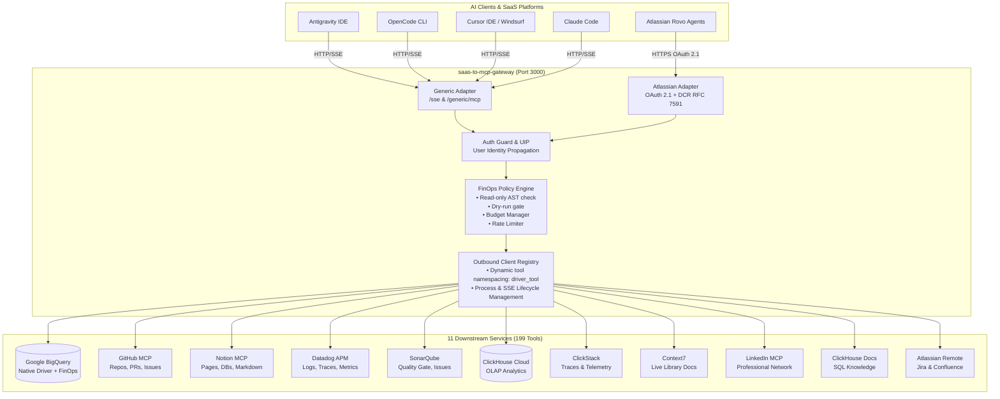

# SaaS-to-MCP Gateway

[](https://www.typescriptlang.org/)
[](https://nodejs.org/)
[](https://modelcontextprotocol.io/)
[](#consolidated-ecosystem-11-services-199-tools)
[](file:///Users/OUT2305/Repo/bigquery-mcp/docker-compose.yaml)
[](file:///Users/OUT2305/Repo/bigquery-mcp/docs/docker.md)
[](file:///Users/OUT2305/Repo/bigquery-mcp/LICENSE)

> **Enterprise Universal Hub & FinOps Gateway for AI Agents & SaaS Platforms**  
> Consolidate multi-agent tool access, dynamic SaaS client registration (OAuth 2.1 RFC 7591 / Atlassian Rovo), and enterprise data governance into a single, high-performance TypeScript Model Context Protocol (MCP) gateway.

---

## Table of Contents

- [Overview & Value Proposition](#overview--value-proposition)
- [Dual-Mode Architecture](#dual-mode-architecture)
- [System Architecture Diagram](#system-architecture-diagram)
- [Consolidated Ecosystem (11 Services, 199 Tools)](#consolidated-ecosystem-11-services-199-tools)
- [Quick Start: Local Hub in 2 Minutes](#quick-start-local-hub-in-2-minutes)
- [Client Configuration Guides (Copy-Paste)](#client-configuration-guides-copy-paste)
  - [OpenCode CLI](#1-opencode-cli)
  - [Google Antigravity IDE](#2-google-antigravity-ide)
  - [Cursor IDE](#3-cursor-ide)
  - [Claude Code](#4-claude-code)
- [Enterprise SaaS Integration (Atlassian Rovo)](#enterprise-saas-integration-atlassian-rovo)
- [BigQuery FinOps Guardrails](#bigquery-finops-guardrails)
- [Production Deployment (Google Cloud Run & Docker)](#production-deployment-google-cloud-run--docker)
- [Configuration Reference](#configuration-reference)
- [Troubleshooting](#troubleshooting)
- [Security & Governance](#security--governance)

---

## Overview & Value Proposition

As engineering organizations adopt AI coding assistants (**Antigravity**, **OpenCode**, **Cursor**, **Claude Code**, **Windsurf**) alongside enterprise AI knowledge agents (**Atlassian Rovo**), two critical architectural problems emerge:

1. **Tool & Token Sprawl in Developer Machines**: Every coding assistant runs its own isolated set of child processes (`npx`, `docker`, `uvx`) and requires individual API tokens hardcoded across multiple editor configs. When a token expires or rotates, every assistant breaks simultaneously.
2. **Lack of Governance & FinOps in Enterprise SaaS**: Connecting external AI agents directly to production data warehouses (like BigQuery) risks catastrophic query billings, data leakage, and untracked agent mutations.

**`saas-to-mcp-gateway` solves both challenges simultaneously** via a unified, modular architecture.

---

## Dual-Mode Architecture

The gateway operates seamlessly in two complementary modes:

```
┌────────────────────────────────────────────────────────────────────────┐
│                        saas-to-mcp-gateway                             │
├───────────────────────────────────┬────────────────────────────────────┤
│   Personal Mode (Local Dev Hub)   │   Enterprise Mode (Cloud Run)      │
├───────────────────────────────────┼────────────────────────────────────┤
│ • Zero-auth /sse & /generic/mcp   │ • OAuth 2.1 (RFC 7591 DCR + PKCE)  │
│ • Consolidates 11 local & remote  │ • Microsoft Entra ID (OIDC SSO)    │
│   tools for AI coding assistants  │ • Stateless JWE / Firestore DCR    │
│ • Single secret management (.env) │ • FinOps label & budget controls   │
│ • Eliminates process duplication  │ • Atlassian Rovo agent gateway     │
└───────────────────────────────────┴────────────────────────────────────┘
```

1. **Personal Mode (Local Development Hub)**:
   - Exposes zero-friction endpoints (`GET /sse`, `POST /messages`, and `POST /generic/mcp`) for local coding agents.
   - Consolidates **199 tools across 11 services** into one persistent background daemon.
   - All credentials (`GITHUB_PERSONAL_ACCESS_TOKEN`, `SONARQUBE_TOKEN`, `DD_API_KEY`, etc.) live securely in one `.env` file.
   - Read the complete [Multi-Agent MCP Consolidation Guide](file:///Users/OUT2305/Repo/bigquery-mcp/docs/consolidation-guide.md).

2. **Enterprise Mode (Production SaaS Gateway)**:
   - Exposes `/atlassian/mcp`, `/register`, `/oauth/authorize`, and `/oauth/token`.
   - Supports Dynamic Client Registration (RFC 7591) for Atlassian Rovo.
   - Full OAuth 2.1 Authorization Code Flow with PKCE and Microsoft Entra ID OIDC SSO.
   - User Identity Propagation (UIP): attaches `user_email` and `mcp_adapter` labels to BigQuery execution jobs for precise FinOps cost attribution.
   - Sliding-window rate limiting and per-user daily byte query quotas.

---

## System Architecture Diagram



---

## Consolidated Ecosystem (11 Services, 199 Tools)

Every tool exposed by the gateway hub is cleanly namespaced as `{driver}_{originalToolName}`, eliminating collisions and enabling clear driver routing:

| Driver | Transport / Bridge | Tools | Highlighted Capabilities | Required Env Vars |
| :--- | :--- | :---: | :--- | :--- |
| **`bigquery`** | Native TypeScript | **5** | Safe schema inspection, dry-run cost estimation, read-only SQL with FinOps labels & row caps | `GOOGLE_APPLICATION_CREDENTIALS`, `GOOGLE_CLOUD_PROJECT` |
| **`github`** | `npx @modelcontextprotocol/server-github` | **26** | Issues, pull requests, file search, commits, branch management, code search | `GITHUB_PERSONAL_ACCESS_TOKEN` |
| **`notion`** | `npx @notionhq/notion-mcp-server` | **24** | Search pages, read databases, retrieve markdown, update content blocks | `NOTION_API_KEY` |
| **`datadog`** | `mcp-remote` SSE Bridge | **30** | Logs analysis, trace spans, metrics aggregation, incident lookup, APM skills | `DD_API_KEY`, `DD_APP_KEY`, `DD_SITE` |
| **`sonarqube`**| `npx sonarqube-api-mcp` | **8** | Quality gate status, rule details, issue context, remediation fix plans | `SONARQUBE_URL`, `SONARQUBE_TOKEN` |
| **`clickhouse`**| `mcp-remote` SSE Bridge | **17** | Analytical queries, database & table listing, slow query pattern diagnostics | `CLICKHOUSE_URL`, `CLICKHOUSE_USER`, `CLICKHOUSE_PASSWORD` |
| **`clickstack`**| `mcp-remote` SSE Bridge | **33** | SQL queries, time series metrics, distributed trace waterfalls, telemetry signals | `CLICKSTACK_API_KEY`, `CLICKSTACK_SERVICE_ID` |
| **`context7`** | `mcp-remote` SSE Bridge | **2** | Real-time up-to-date documentation for any modern software library or framework | `CONTEXT7_API_KEY` |
| **`linkedin`** | `uvx mcp-server-linkedin` | **20** | Profile lookup, company posts, job search, network messaging | `LINKEDIN_COOKIE` |
| **`clickhouse-docs`** | `mcp-remote` SSE Bridge | **2** | Semantic search across ClickHouse documentation and SQL dialect guides | *(Public / None)* |
| **`atlassian`**| `mcp-remote` SSE Bridge | **32** | Confluence pages, Jira issue management, worklogs, transitions, JQL search | `ATLASSIAN_API_TOKEN`, `ATLASSIAN_EMAIL` |
| **Total** | | **199** | | |

---

## Quick Start: Local Hub in 2 Minutes

### 1. Clone & Install
```bash
git clone https://github.com/qybbs/saas-to-mcp-gateway.git
cd saas-to-mcp-gateway
npm install
```

### 2. Configure Environment
```bash
cp .env.example .env
```
Edit `.env` and fill in the API keys for the services you use (unused drivers will gracefully stay inactive).

### 3. Build & Start
```bash
# Compile TypeScript to dist/
npm run build

# Start the gateway daemon
npm start
```

### 4. Verify Health
```bash
curl http://localhost:3000/generic/health
# {"status":"ok","service":"saas-to-mcp-gateway","version":"1.1.0","tools_count":199}
```

---

## Client Configuration Guides (Copy-Paste)

### 1. OpenCode CLI
In `~/.config/opencode/opencode.jsonc`:
```jsonc
{
  "mcp": {
    "gateway-hub": {
      "type": "remote",
      "url": "http://localhost:3000/sse"
    }
  }
}
```

### 2. Google Antigravity IDE
In `~/.gemini/config/mcp_config.json`:
```json
{
  "mcpServers": {
    "gateway-hub": {
      "url": "http://localhost:3000/sse"
    }
  }
}
```

### 3. Cursor IDE
In `~/.cursor/mcp.json` or `.cursor/mcp.json`:
```json
{
  "mcpServers": {
    "gateway-hub": {
      "url": "http://localhost:3000/sse"
    }
  }
}
```

### 4. Claude Code
Run in your terminal:
```bash
claude mcp add --transport sse gateway-hub http://localhost:3000/sse
```

---

## Enterprise SaaS Integration (Atlassian Rovo)

The gateway allows enterprise platforms (like Atlassian Rovo) to discover and call internal database tools securely.

### Registration in Atlassian Administration:
1. Ensure your gateway is exposed over HTTPS (via Cloud Run or Cloudflare Tunnel: `cloudflared tunnel --url http://localhost:3000`).
2. Navigate to **Atlassian Administration** > **Apps** > **Connected apps**.
3. Select **Add external MCP server** > **Custom MCP server**.
4. Enter the base URL: `https://your-domain.com`.
5. Atlassian will dynamically register via RFC 7591 (`POST /register`), initiate OAuth 2.1 PKCE authorization (`/oauth/authorize`), and exchange codes for tokens (`/oauth/token`).
6. Once connected, enterprise users can query allowed BigQuery datasets via Atlassian Chat and Studio Agents.

### Supported DCR Persistence Modes:
- `STATELESS` (Default): Stores client metadata encrypted in the JWE `client_id` with zero database dependencies.
- `MEMORY`: In-memory hashmap for local testing.
- `FIRESTORE`: Stateful, distributed client repository on Google Cloud Firestore.

---

## BigQuery FinOps Guardrails

The gateway enforces a strict 4-step sequence on all BigQuery operations:

```
[1. Discovery]   --> bigquery_list_allowed_tables / search_allowed_tables
        ↓
[2. Inspection]  --> bigquery_describe_table
        ↓
[3. Cost Gate]   --> bigquery_estimate_query_cost (Mandatory Dry-Run)
        ↓
[4. Execution]   --> bigquery_execute_readonly_query (Read-only + FinOps Labels)
```

1. **Table Allowlisting**: Only datasets and tables listed in `ALLOWLIST_TABLES` can be queried.
2. **Comment Stripping & AST Validation**: Eliminates SQL injection and blocks mutative keywords (`INSERT`, `UPDATE`, `DELETE`, `DROP`, `ALTER`).
3. **Cost Protection**: Enforces `MAX_BYTES_BILLED` on every query (e.g. max 10 GB per job).
4. **FinOps Attribution**: Automatically tags Google Cloud BigQuery jobs with sanitized user metadata labels:
   - `user_email`: Sanitized user email (e.g. `user_example_com`).
   - `mcp_adapter`: Originating adapter (`atlassian` or `generic`).

---

## Production Deployment (Google Cloud Run & Docker)

### Deploying to Google Cloud Run
```bash
# 1. Build and push container to Google Artifact Registry
gcloud builds submit --tag asia-southeast1-docker.pkg.dev/<GCP_PROJECT>/<REPO>/saas-to-mcp-gateway:1.1.0

# 2. Deploy stateless service to Cloud Run
gcloud run deploy saas-to-mcp-gateway \
  --image asia-southeast1-docker.pkg.dev/<GCP_PROJECT>/<REPO>/saas-to-mcp-gateway:1.1.0 \
  --region asia-southeast1 \
  --allow-unauthenticated \
  --set-env-vars="MASTER_SECRET_KEY=...,AUTH_PROVIDER=OIDC,DCR_PERSISTENCE_MODE=STATELESS"
```

### Local Docker Compose
```bash
docker-compose up -d
```

---

## Configuration Reference

Key variables in `.env`:

| Variable | Description | Default |
| :--- | :--- | :--- |
| `PORT` | HTTP port for the gateway server | `3000` |
| `MASTER_SECRET_KEY` | 32-byte Base64 secret key for JWE / JWT signing | *(Required in Production)* |
| `DCR_PERSISTENCE_MODE` | Dynamic Client Registration store (`STATELESS`, `MEMORY`, `FIRESTORE`) | `STATELESS` |
| `AUTH_PROVIDER` | Inbound auth provider (`MOCK` or `OIDC`) | `MOCK` |
| `ALLOWED_EMAIL_DOMAINS` | Restrict OAuth login to specific corporate email domains | `*` |
| `MAX_BYTES_BILLED` | Maximum allowed BigQuery bytes scanned per query (FinOps limit) | `10737418240` (10 GB) |
| `ROW_LIMIT` | Hard cap on row results returned to LLMs | `1000` |
| `DAILY_USER_QUERY_QUOTA_MB` | Daily query limit per user | `51200` (50 GB) |
| `USER_RATE_LIMIT_RPM` | Rate limit per user (requests per minute) | `60` |

---

## Troubleshooting

| Symptom | Cause | Solution |
| :--- | :--- | :--- |
| `session not found` on client connect | MCP client connected without initializing SSE session | Use `/sse` endpoint and ensure client adheres to MCP SSE specification. |
| `401 Unauthorized` | Invalid, missing, or expired Bearer Token | Re-authenticate or check `MASTER_SECRET_KEY` consistency across restarts. |
| `Rejected: Query mengandung keyword terlarang` | Query contains non-`SELECT` statements or comments | Ensure query is strictly read-only and free of SQL comment blocks. |
| `maximumBytesBilled limit exceeded` | Query exceeds configured byte scanning cap | Optimize SQL filters using partitioned/clustered columns or adjust `MAX_BYTES_BILLED`. |
| `Driver [...] is disabled or failed to start` | Missing API credentials or executable | Check corresponding `_API_KEY` or `_TOKEN` in `.env` and verify required CLI tools (`npx`, `uvx`) are installed. |

---

## Security & Governance

- **Credential Hygiene**: The gateway strictly loads secrets from `.env` or cloud secret managers. Never commit `.env` or Service Account JSON files.
- **Audit Logging**: Every tool execution is recorded with timestamp, user email, tool name, arguments summary, and BigQuery job ID/bytes scanned.
- **Principle of Least Privilege**: The GCP Service Account requires only `roles/bigquery.dataViewer` and `roles/bigquery.jobUser`.

---

## License

This project is licensed under the [MIT License](file:///Users/OUT2305/Repo/bigquery-mcp/LICENSE).