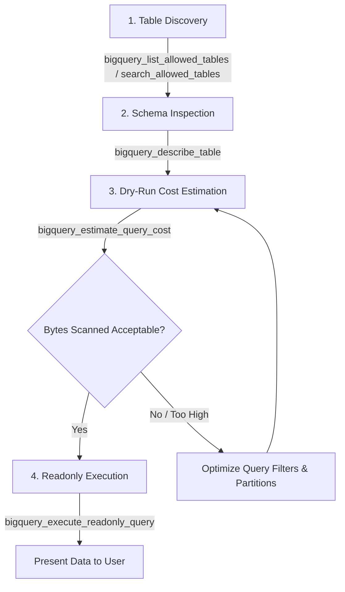

# Enterprise SaaS-to-MCP Gateway Skill

This skill guides AI coding agents on how to interact with the **Enterprise SaaS-to-MCP Gateway**, discover available tools, respect FinOps cost guardrails for data analytics, and leverage integrated downstream tools across 11 distinct domains.

---

## 1. Tool Namespacing & Ecosystem Structure

All tools exposed by the gateway are namespaced with their driver name:
`{driverName}_{originalToolName}`

The gateway consolidates **199 tools** across **11 active drivers**:

| Driver Prefix | Domain | Highlighted Tools | Best Practice for Agents |
| :--- | :--- | :--- | :--- |
| **`bigquery_*`** | Data Warehouse & FinOps | `search_allowed_tables`, `describe_table`, `estimate_query_cost`, `execute_readonly_query` | **Mandatory 4-Step Sequence**: Always estimate cost before executing queries. |
| **`sonarqube_*`** | Code Quality & Security | `search_sonar_issues`, `get_quality_gate_status`, `get_sonar_fix_plan` | Check quality gate status before merging or proposing major refactors. |
| **`github_*`** | Git & Pull Requests | `get_pull_request`, `search_code`, `list_commits`, `create_pull_request_review` | Inspect PR files and diffs directly within your workflow. |
| **`notion_*`** | Knowledge Base & Docs | `post-search`, `retrieve-a-page`, `retrieve-page-markdown` | Retrieve architectural specs and project documentation. |
| **`datadog_*`** | APM, Logs & Telemetry | `search_datadog_spans`, `analyze_datadog_logs`, `load_datadog_skill` | Use `datadog_load_datadog_skill` for domain-specific APM workflows. |
| **`context7_*`** | Real-time Library Docs | `resolve-library-id`, `query-docs` | Call `context7_resolve-library-id` first to get the exact library ID. |
| **`clickhouse_*`** | Cloud OLAP Database | `run_select_query`, `list_databases`, `list_tables` | Run high-performance analytical queries on ClickHouse instances. |
| **`clickstack_*`** | Observability Platform | `clickstack_sql`, `clickstack_timeseries`, `clickstack_trace_waterfall` | Analyze distributed traces and performance bottlenecks. |
| **`atlassian_*`** | Jira & Confluence | `getJiraIssue`, `searchJiraIssuesUsingJql`, `getConfluencePage` | Track Jira tickets and read Confluence requirements. |
| **`linkedin_*`** | Professional Network | `get_person_profile`, `search_posts`, `send_message` | Professional recruitment and company post discovery. |
| **`clickhouse-docs_*`**| Database Documentation | `search-clickhouse-docs`, `ask-question-about-clickhouse` | Query official ClickHouse documentation and SQL syntax guides. |

---

## 2. Mandatory BigQuery Query Protocol (FinOps Guardrails)

When answering data questions or performing BigQuery analysis, you **MUST** follow this 4-step sequence:



### Step 1: Discovery First
- **Never guess or assume table or column names.**
- Call `bigquery_list_allowed_tables()` or `bigquery_search_allowed_tables(keyword="...")` to verify table names.

### Step 2: Schema Inspection
- Call `bigquery_describe_table(datasetId, tableId)` to examine:
  - Exact column names, modes, and data types.
  - Partitioning and clustering fields.

### Step 3: Dry-Run Cost Estimation Gate (Mandatory)
- Before executing any query, **ALWAYS** call `bigquery_estimate_query_cost(sql="...")`.
- Inspect `bytesScannedFormatted` and `estimatedCostUSD`.
- If the query scans excessive data (e.g. > 1 GB for a simple lookup), optimize it with partition filters, explicit `WHERE` clauses, and project only necessary columns (**AVOID `SELECT *`**).

### Step 4: Read-Only Execution
- Only execute queries using `bigquery_execute_readonly_query(sql="...")`.
- Ensure standard GoogleSQL syntax.
- The gateway automatically enforces row limits (max 1000 rows) and labels the query with the user's email for Google Cloud Billing attribution.
- DDL/DML statements (`DROP`, `DELETE`, `UPDATE`, `INSERT`) are strictly rejected by the policy engine.

---

## 3. Special Driver Usage Guidelines

### Datadog Discovery
Datadog ships dynamic skill guides. Before running deep analysis:
1. Run `datadog_load_datadog_skill(skill_name="datadog/traces")` or call `datadog_list_datadog_skills(query="apm")`.
2. Proceed with specialized queries using `datadog_search_datadog_spans` or `datadog_analyze_datadog_logs`.

### Context7 Library Resolution
1. Call `context7_resolve-library-id(libraryName="...", query="...")` to obtain the verified library ID (e.g., `/pmndrs/zustand`).
2. Then call `context7_query-docs(libraryId="/pmndrs/zustand", query="...")` to fetch current code snippets.

---

## 4. Client Connection Configuration

### OpenCode CLI (`~/.config/opencode/opencode.jsonc`)
```jsonc
{
  "mcp": {
    "gateway-hub": {
      "type": "remote",
      "url": "http://localhost:3000/sse"
    }
  }
}
```

### Antigravity IDE (`~/.gemini/config/mcp_config.json`)
```json
{
  "mcpServers": {
    "gateway-hub": {
      "serverUrl": "http://localhost:3000/sse"
    }
  }
}
```

### Cursor IDE (`.cursor/mcp.json`)
```json
{
  "mcpServers": {
    "gateway-hub": {
      "url": "http://localhost:3000/sse"
    }
  }
}
```

### Claude Code CLI
```bash
claude mcp add --transport sse gateway-hub http://localhost:3000/sse
```

### Direct HTTP / curl
```bash
# Discovery
curl -X POST http://localhost:3000/mcp \
  -H "Content-Type: application/json" \
  -d '{"jsonrpc":"2.0","id":1,"method":"tools/list"}'
```
