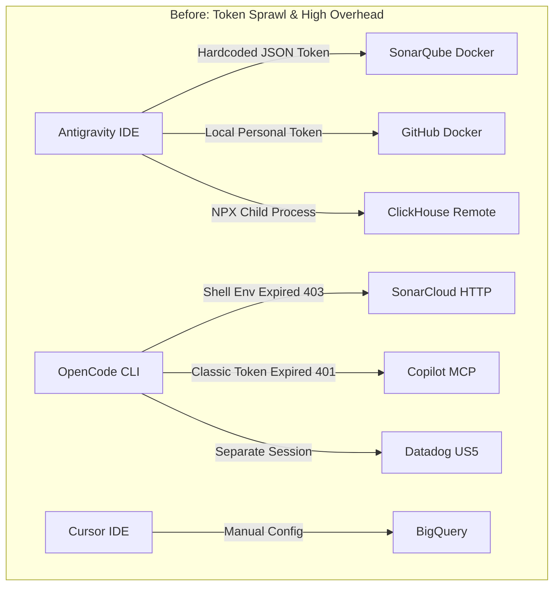
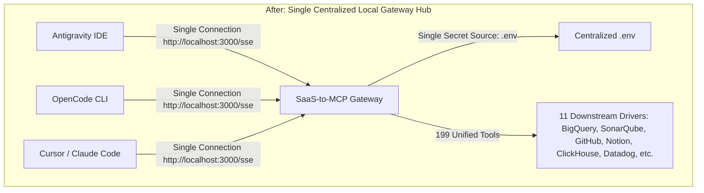

# Multi-Agent MCP Consolidation Guide

A step-by-step handbook for engineers and development teams to **consolidate fragmented local MCP servers** across multiple coding agents (**Antigravity IDE**, **OpenCode**, **Cursor**, **Claude Code**, **Windsurf**) into a single, centralized **SaaS-to-MCP Gateway Hub** (`http://localhost:3000/sse`).

---

## 1. Why Consolidate? (The "Aha!" Moment)

When a developer or engineering team uses more than one AI coding assistant, fragmentation quickly becomes a bottleneck:



### Real-World Problems:
1. **Token Sprawl & Maintenance Nightmare**: SonarQube, GitHub, and Datadog tokens have to be entered repeatedly across multiple editor configs (`mcp_config.json`, `opencode.jsonc`, `.cursor/mcp.json`). Once a token expires, all agents fail simultaneously (`401 Unauthorized` / `403 Forbidden`).
2. **Machine Resource Waste**: Each editor spins up its own separate Node/Python/Docker child processes for the exact same tools.
3. **Cross-Agent Tool Isolation**: OpenCode has Datadog and Context7 but lacks BigQuery. Antigravity has BigQuery and Notion but lacks Datadog.
4. **Uncontrolled Cloud Costs**: No daily query quotas or FinOps billing tags if agents run repeated analytical queries.

### The Solution: SaaS-to-MCP Gateway Hub



---

## 2. Five-Step Consolidation Methodology

### Step 1: Audit Existing Editor Configurations
Inspect each editor's configuration file on your machine:
- **Antigravity IDE**: `~/.gemini/config/mcp_config.json`
- **OpenCode**: `~/.config/opencode/opencode.jsonc`
- **Cursor**: `~/.cursor/mcp.json` or `.cursor/mcp.json` in your workspace
- **Claude Code**: `~/.claude.json`

Note:
1. The transport URL or execution command (`npx`, `docker`, `uvx`, HTTP/SSE).
2. Required credentials and headers (`API_KEY`, `TOKEN`, `headers`).

> [!TIP]
> Create backup copies before modifying original editor configs:
> ```bash
> cp ~/.gemini/config/mcp_config.json ~/.gemini/config/mcp_config.json.backup
> cp ~/.config/opencode/opencode.jsonc ~/.config/opencode/opencode.jsonc.backup
> ```

---

### Step 2: Centralize All Credentials into the Gateway `.env`
Move all tokens to a single `.env` file in the gateway root directory:

```env
# Port & Personal Mode (Unthrottled & Unlimited for Local Dev)
PORT=3000
DCR_PERSISTENCE_MODE=STATELESS
RATE_LIMIT_MAX_REQUESTS=0
USER_DAILY_BUDGET_BYTES=0
LOCAL_USER_EMAIL=developer@localhost

# Downstream Tools Credentials
SONARQUBE_TOKEN=your-sonarqube-token
SONARQUBE_ORG=your-sonar-org
GITHUB_PERSONAL_ACCESS_TOKEN=ghp_your_github_token
NOTION_API_KEY=ntn_your_notion_token
CLICKSTACK_SERVICE_ID=your-clickstack-uuid
DD_API_KEY=your-datadog-api-key
DD_APPLICATION_KEY=your-datadog-app-key
```

---

### Step 3: Register Downstream Drivers in `gateway-mcp-config.json`
Use dynamic `${VAR_NAME}` substitution so secrets are never committed to git:

```json
{
  "outboundDrivers": {
    "bigquery": {
      "type": "bigquery"
    },
    "sonarqube": {
      "type": "stdio",
      "command": "npx",
      "args": ["-y", "sonarqube-api-mcp"],
      "env": {
        "SONAR_HOST_URL": "https://sonarcloud.io",
        "SONAR_TOKEN": "${SONARQUBE_TOKEN}",
        "SONAR_ORGANIZATION": "${SONARQUBE_ORG}"
      }
    },
    "github": {
      "type": "stdio",
      "command": "npx",
      "args": ["-y", "@modelcontextprotocol/server-github"],
      "env": {
        "GITHUB_PERSONAL_ACCESS_TOKEN": "${GITHUB_PERSONAL_ACCESS_TOKEN}"
      }
    },
    "notion": {
      "type": "stdio",
      "command": "npx",
      "args": ["-y", "@notionhq/notion-mcp-server"],
      "env": {
        "OPENAPI_MCP_HEADERS": "{\"Authorization\": \"Bearer ${NOTION_API_KEY}\", \"Notion-Version\": \"2022-06-28\"}"
      }
    },
    "clickhouse-docs": {
      "type": "stdio",
      "command": "npx",
      "args": ["-y", "mcp-remote", "https://clickhouse.com/docs/mcp"]
    },
    "clickhouse": {
      "type": "stdio",
      "command": "npx",
      "args": ["-y", "mcp-remote", "https://mcp.clickhouse.cloud/mcp"]
    },
    "clickstack": {
      "type": "stdio",
      "command": "npx",
      "args": [
        "-y",
        "mcp-remote",
        "https://mcp.clickhouse.cloud/clickstack",
        "--header",
        "x-service-id: ${CLICKSTACK_SERVICE_ID}"
      ]
    },
    "linkedin": {
      "type": "stdio",
      "command": "uvx",
      "args": ["mcp-server-linkedin@latest"],
      "env": {
        "UV_HTTP_TIMEOUT": "300"
      }
    },
    "atlassian": {
      "type": "stdio",
      "command": "npx",
      "args": ["-y", "mcp-remote", "https://mcp.atlassian.com/v2/mcp?tools=all"]
    },
    "context7": {
      "type": "stdio",
      "command": "npx",
      "args": ["-y", "mcp-remote", "https://mcp.context7.com/mcp"]
    },
    "datadog": {
      "type": "stdio",
      "command": "npx",
      "args": [
        "-y",
        "mcp-remote",
        "https://mcp.us5.datadoghq.com/v1/mcp",
        "--header",
        "DD_API_KEY: ${DD_API_KEY}",
        "--header",
        "DD_APPLICATION_KEY: ${DD_APPLICATION_KEY}"
      ]
    },
    "amplitude": {
      "type": "stdio",
      "command": "npx",
      "args": [
        "-y",
        "mcp-remote",
        "https://mcp.amplitude.com/mcp"
      ],
      "timeout": "60s"
    }
  },
  "inboundAdapters": {
    "generic": {
      "enabled": true,
      "allowedDrivers": [
        "bigquery",
        "sonarqube",
        "github",
        "notion",
        "clickhouse-docs",
        "clickhouse",
        "clickstack",
        "linkedin",
        "atlassian",
        "context7",
        "datadog",
        "amplitude"
      ]
    }
  }
}
```

---

### Step 4: Run the Gateway Hub in the Background

```bash
# 1. Build TypeScript code
npm run build

# 2. Start the gateway daemon (or run via Docker / PM2)
npm start
```

Verify in console logs that all drivers initialize cleanly:
```
[DriverManager] Initialized driver: bigquery
[DriverManager] Initialized driver: sonarqube
[DriverManager] Initialized driver: github
[DriverManager] Initialized driver: notion
...
Enterprise SaaS-to-MCP Gateway is running at http://localhost:3000
```

---

### Step 5: Simplify All Client Configurations

#### 1. OpenCode (`~/.config/opencode/opencode.jsonc`)
Replace duplicate or failing servers with a single `gateway-hub` entry:
```jsonc
  "mcp": {
    "gateway-hub": {
      "type": "remote",
      "url": "http://localhost:3000/sse"
    }
  }
```
Verify status with `opencode mcp list`:
```
┌  MCP Servers
│
●  ✓ gateway-hub connected
│      http://localhost:3000/sse
└  ...
```

#### 2. Antigravity IDE (`~/.gemini/config/mcp_config.json`)
Consolidate into:
```json
{
  "mcpServers": {
    "gateway-hub": {
      "serverUrl": "http://localhost:3000/sse"
    },
    "google-developer-knowledge": {
      "serverUrl": "https://developerknowledge.googleapis.com/mcp",
      "authProviderType": "google_credentials"
    }
  }
}
```

#### 3. Cursor IDE (`.cursor/mcp.json`)
```json
{
  "mcpServers": {
    "gateway-hub": {
      "url": "http://localhost:3000/sse"
    }
  }
}
```

#### 4. Claude Code CLI
```bash
claude mcp add --transport sse gateway-hub http://localhost:3000/sse
```

---

## 3. Results & Tangible Benefits

| Metric | Before Consolidation | After Consolidation |
| :--- | :--- | :--- |
| **Secret Management** | Scattered across multiple config files | **Single source of truth (`.env`)** |
| **OpenCode Client Failures** | 3 broken servers (`401`, `403`) | **0 errors (`✓ connected`)** |
| **Total Available Tools** | Fragmented (10–15 per editor) | **199 Unified Tools across all editors** |
| **Background Processes** | Numerous redundant child processes | **1 central multiplexer process** |
| **FinOps & Governance** | None | **GCP billing labels & structured audit logs** |
