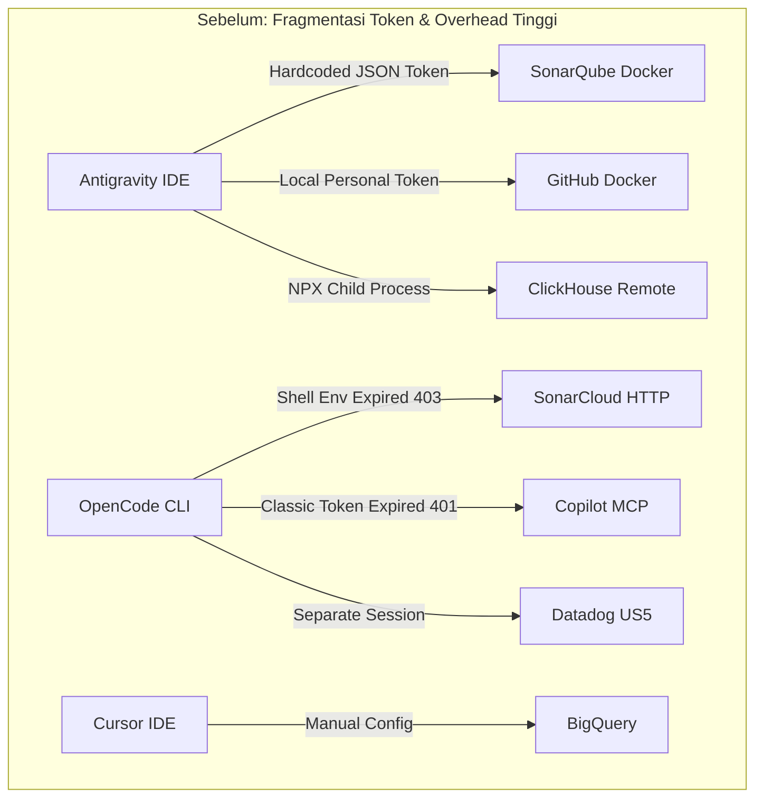

# Multi-Agent MCP Consolidation Guide

Panduan langkah-demi-langkah bagi pengembang dan tim engineering untuk **mengonsolidasikan seluruh MCP server lokal** yang tersebar di berbagai coding agent (**Antigravity IDE**, **OpenCode**, **Cursor**, **Claude Code**, **Windsurf**) ke dalam satu **SaaS-to-MCP Gateway Hub** terpusat (`http://localhost:3000/sse`).

---

## 1. Mengapa Perlu Konsolidasi? (The "Aha!" Moment)

Ketika seorang developer atau tim menggunakan lebih dari satu AI coding assistant, biasanya muncul masalah fragmentasi:



### Masalah Nyata yang Terjadi:
1. **Token Sprawl & Maintenance Nightmare**: Token SonarQube, GitHub, dan Datadog harus dimasukkan berulang kali di tiap file konfigurasi editor (`mcp_config.json`, `opencode.jsonc`, `.cursor/mcp.json`). Begitu token kedaluwarsa, seluruh agent serempak gagal (`401 Unauthorized` / `403 Forbidden`).
2. **Pemborosan Resource Mesin**: Tiap editor menjalankan child process Node/Python/Docker-nya sendiri secara terpisah untuk tool yang sama.
3. **Cross-Agent Isolation**: OpenCode memiliki tool Datadog dan Context7 tetapi tidak bisa mengakses BigQuery. Antigravity memiliki BigQuery dan Notion tetapi tidak memiliki Datadog.
4. **Biaya Cloud Tidak Terkontrol**: Tidak ada batasan query harian (*daily quota*) atau pelabelan (*FinOps billing tags*) jika agent menjalankan kueri data berulang kali.

### Solusi: SaaS-to-MCP Gateway Hub


---

## 2. Metodologi Konsolidasi 5 Langkah

### Langkah 1: Audit Konfigurasi Editor yang Ada
Periksa file konfigurasi masing-masing editor di mesin Anda:
- **Antigravity IDE**: `~/.gemini/config/mcp_config.json`
- **OpenCode**: `~/.config/opencode/opencode.jsonc`
- **Cursor**: `~/.cursor/mcp.json` atau `.cursor/mcp.json` di workspace
- **Claude Code**: `~/.claude.json`

Catat:
1. URL atau command yang dipanggil (`npx`, `docker`, `uvx`, HTTP/SSE).
2. Kredensial atau token yang dibutuhkan (`API_KEY`, `TOKEN`, `headers`).

> [!TIP]
> Buat salinan cadangan (*backup*) sebelum mengubah konfigurasi asli:
> ```bash
> cp ~/.gemini/config/mcp_config.json ~/.gemini/config/mcp_config.json.backup
> cp ~/.config/opencode/opencode.jsonc ~/.config/opencode/opencode.jsonc.backup
> ```

---

### Langkah 2: Sentralisasi Seluruh Kredensial ke `.env` Gateway
Pindahkan seluruh token ke satu file `.env` di direktori gateway:

```env
# Port & Personal Mode (Unthrottled & Unlimited untuk Local Dev)
PORT=3000
DCR_PERSISTENCE_MODE=STATELESS
RATE_LIMIT_MAX_REQUESTS=0
USER_DAILY_BUDGET_BYTES=0
LOCAL_USER_EMAIL=developer@localhost

# Downstream Tools Credentials
SONARQUBE_TOKEN=your-sonarqube-token
SONARQUBE_ORG=your-sonar-org
GITHUB_PERSONAL_ACCESS_TOKEN=ghp_your_github_token
NOTION_API_KEY=ntn_your_notion_token
CLICKSTACK_SERVICE_ID=your-clickstack-uuid
DD_API_KEY=your-datadog-api-key
DD_APPLICATION_KEY=your-datadog-app-key
```

---

### Langkah 3: Daftarkan Downstream Drivers di `gateway-mcp-config.json`
Gunakan interpolasi `${VAR_NAME}` dinamis agar rahasia tidak pernah ter-commit ke git:

```json
{
  "outboundDrivers": {
    "bigquery": {
      "type": "bigquery"
    },
    "sonarqube": {
      "type": "stdio",
      "command": "npx",
      "args": ["-y", "sonarqube-api-mcp"],
      "env": {
        "SONAR_HOST_URL": "https://sonarcloud.io",
        "SONAR_TOKEN": "${SONARQUBE_TOKEN}",
        "SONAR_ORGANIZATION": "${SONARQUBE_ORG}"
      }
    },
    "github": {
      "type": "stdio",
      "command": "npx",
      "args": ["-y", "@modelcontextprotocol/server-github"],
      "env": {
        "GITHUB_PERSONAL_ACCESS_TOKEN": "${GITHUB_PERSONAL_ACCESS_TOKEN}"
      }
    },
    "notion": {
      "type": "stdio",
      "command": "npx",
      "args": ["-y", "@notionhq/notion-mcp-server"],
      "env": {
        "OPENAPI_MCP_HEADERS": "{\"Authorization\": \"Bearer ${NOTION_API_KEY}\", \"Notion-Version\": \"2022-06-28\"}"
      }
    },
    "clickhouse-docs": {
      "type": "stdio",
      "command": "npx",
      "args": ["-y", "mcp-remote", "https://clickhouse.com/docs/mcp"]
    },
    "clickhouse": {
      "type": "stdio",
      "command": "npx",
      "args": ["-y", "mcp-remote", "https://mcp.clickhouse.cloud/mcp"]
    },
    "clickstack": {
      "type": "stdio",
      "command": "npx",
      "args": [
        "-y",
        "mcp-remote",
        "https://mcp.clickhouse.cloud/clickstack",
        "--header",
        "x-service-id: ${CLICKSTACK_SERVICE_ID}"
      ]
    },
    "linkedin": {
      "type": "stdio",
      "command": "uvx",
      "args": ["mcp-server-linkedin@latest"],
      "env": {
        "UV_HTTP_TIMEOUT": "300"
      }
    },
    "atlassian": {
      "type": "stdio",
      "command": "npx",
      "args": ["-y", "mcp-remote", "https://mcp.atlassian.com/v1/sse"]
    },
    "context7": {
      "type": "stdio",
      "command": "npx",
      "args": ["-y", "mcp-remote", "https://mcp.context7.com/mcp"]
    },
    "datadog": {
      "type": "stdio",
      "command": "npx",
      "args": [
        "-y",
        "mcp-remote",
        "https://mcp.us5.datadoghq.com/v1/mcp",
        "--header",
        "DD_API_KEY: ${DD_API_KEY}",
        "--header",
        "DD_APPLICATION_KEY: ${DD_APPLICATION_KEY}"
      ]
    }
  },
  "inboundAdapters": {
    "generic": {
      "enabled": true,
      "allowedDrivers": [
        "bigquery",
        "sonarqube",
        "github",
        "notion",
        "clickhouse-docs",
        "clickhouse",
        "clickstack",
        "linkedin",
        "atlassian",
        "context7",
        "datadog"
      ]
    }
  }
}
```

---

### Langkah 4: Jalankan Gateway Hub di Latar Belakang

```bash
# 1. Build kode TypeScript
npm run build

# 2. Jalankan server (atau gunakan PM2 / Docker)
npm start
```

Periksa log konsol untuk memastikan seluruh driver berhasil diinisialisasi:
```
[DriverManager] Initialized driver: bigquery
[DriverManager] Initialized driver: sonarqube
[DriverManager] Initialized driver: github
[DriverManager] Initialized driver: notion
...
Enterprise SaaS-to-MCP Gateway is running at http://localhost:3000
```

---

### Langkah 5: Sederhanakan Konfigurasi Seluruh Klien

#### 1. OpenCode (`~/.config/opencode/opencode.jsonc`)
Hapus semua server yang duplikat/gagal, sisakan hanya `gateway-hub`:
```jsonc
  "mcp": {
    "gateway-hub": {
      "type": "remote",
      "url": "http://localhost:3000/sse"
    }
  }
```
Verifikasi dengan `opencode mcp list`:
```
┌  MCP Servers
│
●  ✓ gateway-hub connected
│      http://localhost:3000/sse
└  ...
```

#### 2. Antigravity IDE (`~/.gemini/config/mcp_config.json`)
Sederhanakan menjadi:
```json
{
  "mcpServers": {
    "gateway-hub": {
      "serverUrl": "http://localhost:3000/sse"
    },
    "google-developer-knowledge": {
      "serverUrl": "https://developerknowledge.googleapis.com/mcp",
      "authProviderType": "google_credentials"
    }
  }
}
```

#### 3. Cursor IDE (`.cursor/mcp.json`)
```json
{
  "mcpServers": {
    "gateway-hub": {
      "url": "http://localhost:3000/sse"
    }
  }
}
```

#### 4. Claude Code CLI
```bash
claude mcp add --transport sse gateway-hub http://localhost:3000/sse
```

---

## 3. Hasil & Manfaat Nyata

| Indikator | Sebelum Konsolidasi | Sesudah Konsolidasi |
| :--- | :--- | :--- |
| **Penyimpanan Token** | Tercecer di 3 file konfigurasi | **1 file tunggal (`.env`)** |
| **Server Failures di OpenCode** | 3 server error (`401`, `403`) | **0 error (`✓ connected`)** |
| **Total Tools Tersedia** | Terfragmentasi (10–15 per editor) | **199 Tools serentak di semua editor** |
| **Process Daemon** | Banyak background child process | **1 central multiplexer process** |
| **FinOps & Audit** | Tidak ada | **Labeling billing GCP & JSON audit logs** |
