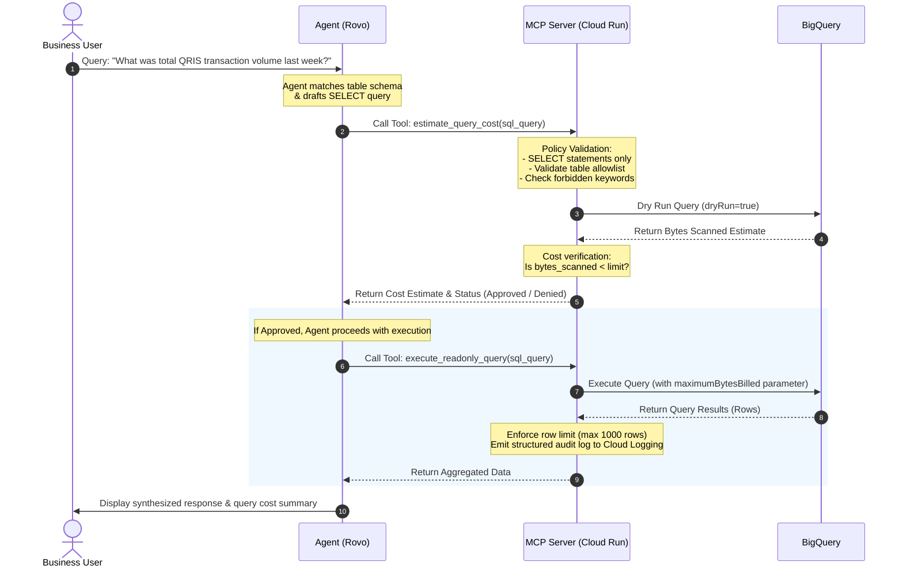
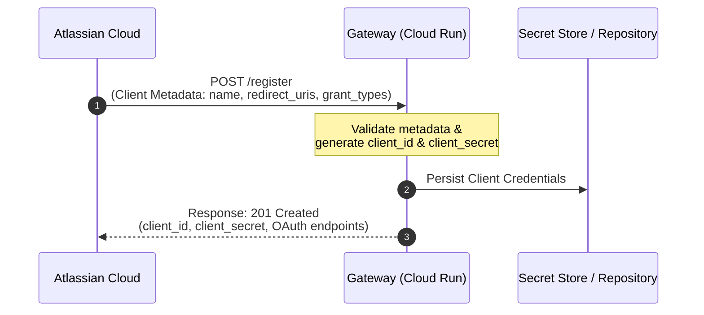
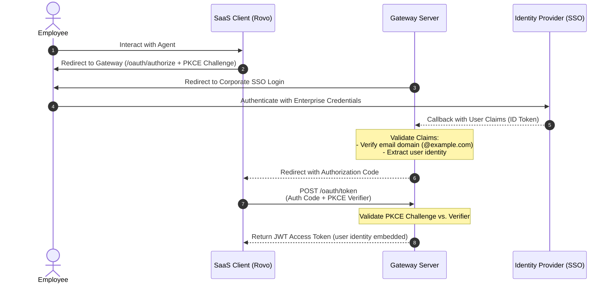

# Detailed Architecture: Enterprise SaaS-to-MCP Gateway for AI Agents

This document details the technical design for the **Enterprise SaaS-to-MCP Gateway** deployed to Cloud Run, enabling AI Agents (such as Atlassian Rovo) to execute BigQuery queries safely, measurably, and with full auditability.

**Decision Objective**  
Define an enterprise target design that is secure for pilot validation, lightweight to build, and expandable toward mature audit and user identity attribution models.

## Design Summary

The architecture places a corporate-governed control layer between the SaaS Agent (Rovo) and BigQuery. This layer acts as an **MCP Server** and a centralized policy enforcement point for query validation, dataset restrictions, cost estimation, audit logging, and output control. Compared to managed alternatives, this approach provides granular guardrails and observability with predictable build and maintenance effort.

For initial phases, the most realistic model employs a **shared service account with custom audit enrichment**. Queries execute via a designated service account, while every request records the originating user identity from the SaaS layer when available. This model avoids complex per-query impersonation while delivering complete traceability for enterprise governance.

## Context and Design Goals

A custom gateway is required for the following technical and governance reasons:

* SaaS Admin Hubs (e.g., Atlassian Rovo) require standard Streamable HTTP with OAuth 2.1 / DCR, which cannot connect directly to Google-managed endpoints without compatible authentication bridges.
* Native BigQuery endpoints lack granular guardrails, specifically `max_bytes_billed` hard caps, dataset allowlists, and per-user attribution.
* Enterprise business users require intuitive, actionable error feedback rather than raw database exceptions.

Initial design goals:

* Support **read-only analytics** strictly.
* Expose only **allowlisted datasets**.
* Mandate **cost estimation** prior to execution.
* Prioritize **aggregated results** over raw customer records.
* Maintain an immutable **audit trail** for observability and compliance.

## Target Architecture

Proposed primary lifecycle:

1. A user submits a query to the SaaS Agent (e.g., in Rovo).
2. The Agent determines an MCP tool call is required.
3. Rovo calls the Gateway MCP Server endpoint hosted on Cloud Run.
4. The MCP Server validates tool requests, user context, query intent, and security policies.
5. The MCP Server executes a dry run against BigQuery to estimate scanned bytes.
6. If approved by policy, the MCP Server executes the read-only query in BigQuery.
7. Sanitized and capped results are returned to the Agent.
8. Request logs, SQL text, estimates, result metadata, and outcomes are dispatched to audit sinks.

### Architecture & Data Flow Diagrams

#### 1. Network Boundary & Component Architecture
The following diagram illustrates network boundaries, protocols, and the interaction between GCP components and Atlassian Cloud.

```mermaid
graph TD
    subgraph Atlassian Cloud
        Rovo[Agent in Rovo]
    end

    subgraph Internet
        HTTPS[HTTPS Traffic / Protected by OAuth 2.1]
    end

    subgraph Google Cloud Platform (GCP)
        subgraph Cloud Run
            MCPServer[Custom MCP Server<br>Node.js or Python]
        end
        
        subgraph Security & Config
            SecretMgr[Secret Manager<br>OAuth Clients / Config]
            CloudLogging[Cloud Logging<br>Structured Request Logs]
        end

        subgraph BigQuery Data Warehouse
            BQEngine[BigQuery Query Engine]
            subgraph Datasets
                AllowlistDB[Allowlisted Datasets<br>Read-Only Access]
                AuditTable[Audit Log Table]
                RestrictedDB[Restricted Datasets<br>Blocked by IAM]
            end
        end
    end

    Rovo -->|1. Tool Call| HTTPS
    HTTPS -->|2. Ingress Route| MCPServer
    MCPServer -.->|Read Auth Config| SecretMgr
    MCPServer -->|3. Dry Run / Execute| BQEngine
    BQEngine -->|4. Query Data| AllowlistDB
    BQEngine -.->|Access Denied| RestrictedDB
    MCPServer -.->|5. Write Logs| CloudLogging
    CloudLogging -.->|Log Sink| AuditTable
    MCPServer -->|6. Return Aggregated Data| Rovo
```

#### 2. Sequence Diagram (Query Interaction Lifecycle)
This diagram illustrates the two-stage execution lifecycle (estimate -> execute) between the Agent, Custom MCP Server, and BigQuery.



### Components

| Component | Role | Architectural Notes |
| --- | --- | --- |
| SaaS Agent in Rovo | User interface and reasoning layer | Synthesizes intent, requests clarifications, and calls MCP tools per instructions. |
| External MCP Server on Cloud Run | Policy enforcement and tool execution layer | Core gateway engine; manages query validation, authentication, and BigQuery integration. |
| BigQuery | Execution engine and metadata store | Read-only; access is strictly scoped to allowlisted datasets. |
| Cloud Logging / BigQuery Audit Table | Observability and audit trail | Retains per-request events, cost estimates, and execution outcomes. |

## Cost Forecasting

### Cost Components

| Component | Pricing Unit | Notes |
| --- | --- | --- |
| **Cloud Run — CPU** | $0.000024 / vCPU-second | Free tier: 180,000 vCPU-sec/month |
| **Cloud Run — Memory** | $0.0000025 / GiB-second | Free tier: 360,000 GiB-sec/month |
| **Cloud Run — Requests** | $0.40 / million requests | Free tier: 2 million requests/month |
| **BigQuery — On-demand** | $6.25 / TB scanned | Free tier: 1 TB/month |
| **Secret Manager** | $0.06 / 10k operations | Service account & OAuth credentials |
| **Cloud Logging** | $0.50 / GiB beyond 50 GiB | Custom structured audit logs |

### Baseline Assumptions

| Parameter | Value |
| --- | --- |
| Cloud Run allocation | 1 vCPU, 512 MiB memory |
| Average duration per request | ~3 seconds, including BigQuery execution |
| Average data scanned per query | ~200 MB (assuming aggregated, partitioned, and filtered queries) |
| Minimum instances | 0 (scale-to-zero, serverless) |
| Query types | Read-only aggregation (COUNT, SUM, AVG, GROUP BY) |
| Datasets | Date-partitioned and clustered |

### Monthly Cost Scenarios

* **Scenario 1 — PoC (3–5 users, ~1,000 queries/month)**

| Component | Calculation | Cost |
| --- | --- | --- |
| Cloud Run | 3,000 vCPU-sec + 1,500 GiB-sec + 1k requests → within free tier | ~$0 |
| BigQuery | 1,000 × 200 MB = 200 GB → within 1 TB free tier | ~$0 |
| Supporting services | Secret Manager + minimal Logging | ~$1 |
| **Total PoC** | | **~$1/month** |

* **Scenario 2 — Pilot (10–20 users, ~5,000 queries/month)**

| Component | Calculation | Cost |
| --- | --- | --- |
| Cloud Run | 15,000 vCPU-sec + 7,500 GiB-sec + 5k requests → within free tier | ~$0 |
| BigQuery | 5,000 × 200 MB = 1 TB → near free tier boundary | ~$0 – $3 |
| Supporting services | Secret Manager + Logging | ~$3 – $5 |
| **Total Pilot** | | **~$3 – $8/month** |

* **Scenario 3 — Production (50–100 users, ~15,000 queries/month)**

| Component | Calculation | Cost |
| --- | --- | --- |
| Cloud Run (scale-to-zero) | 45,000 vCPU-sec → within free tier | ~$0 |
| Cloud Run (min 1 instance, eliminating cold starts) | ~2.6M vCPU-sec billed + memory | ~$65 – $70 |
| BigQuery | 15,000 × 200 MB = 3 TB → 2 TB charged × $6.25 | ~$12.50 |
| BigQuery (larger average scan ~500 MB) | 7.5 TB → 6.5 TB × $6.25 | ~$40.63 |
| Supporting services | Logging + Secret Manager + monitoring | ~$10 – $15 |
| **Total Production (scale-to-zero)** | | **~$23 – $56/month** |
| **Total Production (min 1 instance)** | | **~$88 – $126/month** |

### Worst-Case Scenario — Without Guardrails

| Condition | Calculation | Cost |
| --- | --- | --- |
| Full table scans without partition filters, average 5 GB/query | 15,000 × 5 GB = 75 TB → 74 TB × $6.25 | **~$463/month** |
| **With guardrail** `max_bytes_billed = 1 GB` | Capped: 15 TB max → 14 TB × $6.25 | **~$88/month** |

### Insights & Summary

| Aspect | Insight |
| --- | --- |
| **PoC is negligible** | At PoC volumes (≤1,000 queries), almost all costs are absorbed by GCP free tiers ($0–$1/month). |
| **BigQuery is dominant** | Query scanning costs vastly outweigh compute costs. Optimization must focus on partition filtering and column projection. |
| **Cold start vs. cost** | Scale-to-zero is cost-free when idle with 2–5s cold start. 1 warm instance costs ~$65–$70/month for consistent latency. Recommendation: use scale-to-zero for PoC/Pilot. |
| **`max_bytes_billed` is critical** | This single parameter caps worst-case cost exposure from ~$463 down to ~$88/month. Mandatory from Day 1. |

* **Cost Comparison: Option 1 vs. Option 2**

| Aspect | Option 1 (Google Managed) | Option 2 (Self-hosted Gateway) |
| --- | --- | --- |
| Infrastructure cost | $0 (serverless) | $0 – $70/month (depending on min instances) |
| BigQuery cost | Identical ($6.25/TB on-demand) | Identical ($6.25/TB on-demand) |
| Cost governance | Limited (IAM limits only) | Full (`max_bytes_billed` + daily user quotas) |
| Worst-case protection | Low (no per-query hard cap) | High (hard caps per query and per user) |
| Development effort | ~Days | ~2–3 weeks |
| Maintenance overhead | $0 | ~2–4 hours/month for updates |

## Architectural Recommendations

* Deploy the MCP Server to Cloud Run with scale-to-zero enabled for PoC/pilot phases.
* Use a designated shared Service Account for query execution during initial phases.
* Embed custom audit enrichment in the Gateway layer to associate every request with the originating user identity.
* Restrict execution strictly to `SELECT` queries with mandatory dry runs and hard-coded `max_bytes_billed`.

## Application Component Design

### 1. MCP Transport Layer

In accordance with [Atlassian integration requirements](https://support.atlassian.com/organization-administration/docs/add-an-external-mcp-server-from-atlassian-administration/), the server must expose an MCP endpoint over **Streamable HTTP transport**.
* **Transport Requirement**: Atlassian Cloud **DOES NOT SUPPORT** SSE-only (Server-Sent Events only) or `stdio` (standard I/O). The server must implement Streamable HTTP (standard HTTP POST request/response).
* **Network & Ingress**: Because the SaaS runtime resides in the cloud, endpoints must be publicly accessible via HTTPS with valid TLS certificates (managed natively by Cloud Run).

### 2. Tool Handler Layer

This layer maps MCP JSON schemas into internal server logic. Rather than exposing generic, unrestricted tools, the gateway implements a **specialized, constrained tool contract** designed around the lifecycle: **Discovery ➔ Schema ➔ Cost Estimation ➔ Execution**.

*   `list_allowed_tables`
    *   **Description**: Returns table names, dataset IDs, and descriptions approved on the gateway allowlist.
    *   **Technical Behavior**: Isolates the Agent from discovering sensitive schemas outside the approved scope.
    *   **Under the Hood**: Reads static allowlist configurations from environment variables or Secret Manager.
*   `describe_table`
    *   **Description**: Accepts a table name and returns column details (data types, descriptions, sensitivity tags).
    *   **Technical Behavior**: Enables the Agent to craft precise SQL queries while avoiding sensitive personal data columns.
    *   **Under the Hood**: Queries `INFORMATION_SCHEMA.COLUMNS` with read-only permissions.
*   `estimate_query_cost`
    *   **Description**: Evaluates draft SQL queries through the Policy Engine and executes a BigQuery dry run to determine bytes scanned.
    *   **Technical Behavior**: Returns bytes scanned, estimated billing cost, and approval status.
    *   **Under the Hood**: Invokes BigQuery API with `dryRun = true` (which incurs zero GCP billing).
*   `execute_readonly_query`
    *   **Description**: Executes verified read-only SQL queries against BigQuery.
    *   **Technical Behavior**: Caps output rows (e.g., maximum 1,000 rows) to prevent payload bloat.
    *   **Under the Hood**: Submits query jobs with `maximumBytesBilled` enforced at the database layer as a fail-safe.

> [!TIP]
> **Separation of Concerns:** This separation prevents impulsive agent behavior. If an Agent attempts to call `execute_readonly_query` directly without prior estimation, the Gateway can reject the request to enforce user cost transparency.

### 3. Policy Engine

All incoming SQL queries must pass through the following validations prior to execution:

* Must be a `SELECT` statement (or `WITH ... SELECT`).
* Block forbidden keywords: `INSERT`, `UPDATE`, `DELETE`, `MERGE`, `CREATE`, `DROP`, `ALTER`, scripting, and multi-statements.
* Datasets and tables must exist in the allowlist.
* Sensitive fields must be blocked via column-level security and explicit denylists.
* Must pass dry-run verification.
* Projected bytes scanned must fall below configured thresholds.
* Row limits must be enforced on result sets.

> [!NOTE]  
> Query validation must not rely merely on substring matching. It requires AST-aware tokenization or normalization to detect multi-statement attacks, comment evasion, and dialect-specific bypasses.

### 4. BigQuery Execution Layer

This layer executes queries using a dedicated runtime Service Account (e.g., `saas-mcp-agent@...`) configured with least privilege: **job execution** and **read access** scoped strictly to allowlisted datasets.

Execution safeguards:

* `dryRun = true` for cost pre-checks.
* `maximumBytesBilled` for hard cost boundaries.
* Application-level `timeoutMs` (e.g., 15 seconds).
* Job labels (`source=saas_mcp`, `env=production`, and normalized `user_email`).

### 5. Audit and Observability Layer

Per-request audit payload:

* Request timestamp
* Request ID
* User identity (email from OAuth context)
* Tool name
* Prompt summary or hash
* Executed SQL text
* Estimated dry-run bytes scanned
* Target datasets and tables
* Execution status
* Denial reason or error code (if rejected)
* Returned row count
* BigQuery Job ID and actual bytes billed

Audit logs are emitted as structured JSON to Cloud Logging and can be routed to a BigQuery audit dataset for reporting and FinOps reconciliation.

## Technical Implementation Options

| Option | Description | Pros | Cons |
| --- | --- | --- | --- |
| Google MCP Toolbox | Use Google's open-source toolbox with a policy wrapper | Faster setup, pre-built BigQuery connectivity | Requires extensive customization for enterprise policy and custom UX |
| Lightweight Custom Server | Purpose-built gateway tailored for SaaS agents | Total control over tools, policies, and response formats | Higher initial build effort |
| Hybrid | Use core driver abstractions with internal policy middleware | Optimal balance between speed and control | Slightly higher architectural complexity |
| Proxy to Managed MCP | Reverse proxy to Google Managed BigQuery MCP | Zero BigQuery SDK integration code | Requires deep JSON-RPC packet inspection and lacks native cost caps |

**Recommendation:** Adopt the **Custom Gateway / Hybrid** approach to achieve strict cost caps, custom tool schemas, and zero data leakage.

### Why Avoid Proxying to Google Managed BigQuery MCP?

1. **No Granular Cost Protection (`maximumBytesBilled`)**: The Google Managed MCP schema does not expose `maximumBytesBilled`. Without it, runaway queries cannot be blocked at the database level.
2. **Double Network Round-Trip**: Enforcing dry-run estimates via a proxy requires intercepting the call, firing a dry-run query, evaluating the response, and then firing the execution query—doubling network latency.
3. **JSON-RPC Inspection Overhead**: A proxy must unpack, parse, sanitize, and repack JSON-RPC payloads, creating high code complexity and security risks.
4. **Rigid Tool Schemas**: Managed schemas cannot be customized into streamlined business contracts (e.g., separating `estimate_query_cost` from execution).

## Security & Governance Guardrails

| Domain | Recommended Control | Implementation |
| --- | --- | --- |
| Gateway Authentication | OAuth 2.1 with Authorization Code + PKCE | Custom OAuth 2.1 Server with Dynamic Client Registration (RFC 7591) |
| Ingress Security | Publicly accessible but strongly authenticated | Cloud Run + TLS 1.3 + strict token verification |
| BigQuery Access | Principle of Least Privilege | Dedicated service account, dataset-level reader, jobUser |
| Query Safety | Read-only enforcement + dry-run + cost caps | Lexical parser, `maximumBytesBilled`, execution timeouts |
| Data Sensitivity | Aggregation-first principle | Column-level security + dataset allowlist |
| Observability | Comprehensive audit trail | Structured Cloud Logging + BigQuery audit table sink |

### Ingress & IAM Specifications

#### 1. Ingress Security & Authentication
* **HTTPS & TLS**: Enforce TLS 1.2/1.3 with managed custom domain certificates (e.g., `mcp.enterprise.com`).
* **Dynamic Client Registration (DCR - RFC 7591)**: The gateway provides a `/register` endpoint allowing SaaS platforms (e.g., Atlassian) to register OAuth clients automatically.
* **OAuth 2.1 & PKCE**: User authorization requires Authorization Code Grant with S256 PKCE challenges:
  * `/oauth/authorize`: User authorization endpoint (federated with Corporate SSO / Entra ID).
  * `/oauth/token`: Token exchange endpoint verifying PKCE verifiers.
* **Bearer Token Validation**: Incoming MCP requests must include `Authorization: Bearer <TOKEN>`.
* **Rate Limiting**: Configured sliding-window rate limiters per client/user to safeguard endpoints against denial-of-service.

#### 2. IAM Least Privilege Matrix
The runtime service account (`saas-mcp-agent@...`) requires the following granular roles:

| Resource | Role / Permission | Purpose | Scope |
| --- | --- | --- | --- |
| **GCP Project** | `roles/bigquery.jobUser` | Submit and manage query jobs | Project Level |
| **BigQuery Dataset** | `roles/bigquery.dataViewer` | Read metadata and data in allowlisted datasets | Dataset Level |
| **GCP Project / Logging** | `roles/logging.logWriter` | Write structured audit logs | Project Level |
| **Secret Manager** | `roles/secretmanager.secretAccessor` | Access encryption keys and secrets | Secret Level |

> [!WARNING]
> Never grant `roles/bigquery.admin` or `roles/bigquery.dataEditor` to runtime service accounts.

## OAuth 2.1 & DCR Authentication Lifecycle

### 1. Dynamic Client Registration (DCR - RFC 7591)
Client registration occurs automatically when the administrator configures the gateway in the SaaS management console:



### 2. User Authorization & SSO Federation (OAuth 2.1 + PKCE)



### 3. Modular Persistence Architecture
The Gateway supports three configurable storage modes via `DCR_PERSISTENCE_MODE`:
* **`STATELESS`**: Pure zero-database mode using encrypted JSON Web Encryption (JWE) tokens for `client_id` and authorization codes, ideal for zero-cost serverless deployments.
* **`MEMORY`**: Ephemeral in-memory map for local development and integration testing.
* **`FIRESTORE`**: Distributed cloud persistence in Google Cloud Firestore for clustered enterprise deployments.

---

## Verification & Testing Scenario Matrix

| ID | Category | Test Scenario | Input / Action | Expected Outcome |
| :--- | :--- | :--- | :--- | :--- |
| **TC-01** | **DCR** | Dynamic Client Registration | POST to `/register` with valid metadata | HTTP 201 Created, returns `client_id` and OAuth endpoints. |
| **TC-02** | **SSO** | Valid Corporate Login | Authorize with `@example.com` email | Successful login, redirected with Authorization Code. |
| **TC-03** | **SSO** | Blocked External Domain | Authorize with `@external.com` email | Access denied (HTTP 403 Forbidden). |
| **TC-04** | **OAuth** | PKCE S256 Exchange (Success) | POST to `/oauth/token` with matching `code_verifier` | HTTP 200 OK, returns signed JWT Access Token. |
| **TC-05** | **OAuth** | PKCE Verification Failure | POST to `/oauth/token` with invalid verifier | HTTP 400 Bad Request (`Invalid Grant`). |
| **TC-06** | **Auth Token** | Missing Bearer Token | Request `/mcp` without `Authorization` header | HTTP 401 Unauthorized. |
| **TC-07** | **Auth Token** | Expired Access Token | Request `/mcp` with expired JWT | HTTP 401 Unauthorized. |
| **TC-08** | **Policy** | Valid `SELECT` Query | Aggregation query on allowlisted table below cost limits | HTTP 200 OK, returns formatted results. |
| **TC-09** | **Policy** | DDL/DML Rejection | Query containing `DROP TABLE` or `DELETE` | Request rejected by Policy Engine (HTTP 400 / Policy Violation). |
| **TC-10** | **Policy** | Large Query Cost Protection | Unfiltered scan exceeding `max_bytes_billed` | Job aborted natively by BigQuery / Policy Engine. |
| **TC-11** | **Policy** | Non-Allowlisted Dataset | Query referencing unauthorized tables | Rejected at Policy layer before reaching database. |

---

## Identity & FinOps Attribution Model

The Gateway implements **User Identity Propagation (UIP)**:
* BigQuery jobs execute using the Gateway's runtime Service Account.
* The Gateway forwards a normalized `ToolContext` (`userEmail`, `adapterName`, `requestId`) to all drivers.
* The BigQuery driver attaches GCP labels (`user_email`, `mcp_adapter`) to every job, enabling granular per-user cost tracking in Google Cloud Billing while using a shared Service Account.
* Execution metadata (`jobId`, `actualBytesBilled`) is emitted in structured audit logs and tracked against daily user quotas.

## Risk Assessment & Mitigations

| Risk | Impact | Architectural Mitigation |
| --- | --- | --- |
| Runaway query costs in BigQuery | Budget overrun | Mandatory dry runs, hard-coded `max_bytes_billed`, and mandatory partition filtering |
| Public endpoint exposure | Unauthorized access | Strong OAuth 2.1 + PKCE authentication, rate limiting, and structured audit logs |
| Sensitive customer data leakage | Compliance violation | Table allowlists, column-level security, denylists, and aggregation-first outputs |
| Incomplete user auditability | Audit failure | Systematic logging of `requestId`, user email, SQL text, and execution metrics |
| Operational overhead | Maintenance strain | Modular driver architecture, declarative configuration, and containerized deployment |

## Infrastructure & Reference Patterns

The gateway follows established enterprise deployment patterns:
* **Registry**: Google Artifact Registry (`asia-southeast1-docker.pkg.dev`).
* **Build Tool**: Google Cloud Build or automated GitHub Actions workflows.
* **Deployment Target**: Google Cloud Run with Application Default Credentials (ADC).
* **Secrets Management**: GCP Secret Manager for encryption keys and API tokens.

## References

* [Atlassian Admin: Add an external MCP server from Atlassian Administration](https://support.atlassian.com/organization-administration/docs/add-an-external-mcp-server-from-atlassian-administration/)
* [Atlassian Admin: Configure tools for an external MCP server](https://support.atlassian.com/organization-administration/docs/configure-tools-for-an-external-mcp-server/)
* [Atlassian Rovo MCP overview](https://support.atlassian.com/rovo/docs/rovo-dev-and-model-context-protocol-mcp/)
* [Model Context Protocol Specification](https://modelcontextprotocol.io/)
* [Google Cloud Run: Connect to Cloud SQL and BigQuery](https://cloud.google.com/run/docs/tutorials)
* [Google Cloud Run permissions to query BigQuery](https://stackoverflow.com/questions/59107407/google-cloud-run-permissions-to-query-bigquery)