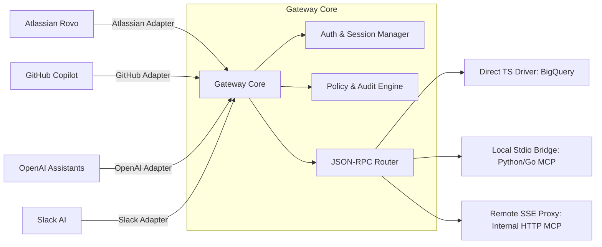

# Roadmap: Enterprise SaaS-to-MCP Adapter Gateway

This roadmap outlines the evolution of the project from a BigQuery & Atlassian specific MCP server into a universal, secure, and modular **Enterprise SaaS-to-MCP Adapter Gateway**.

---

## Target Architecture Overview

---

## Development Phases Breakdown

### Phase 1: Architecture Decoupling & Isolation (Foundations) [COMPLETED]
This phase focuses on isolating Atlassian-specific logic from the core gateway engine into independent modules and laying the foundation for shared modules.

*   **Inbound Adapter Decoupling (Atlassian)**:
    *   Migrate Dynamic Client Registration (DCR) and token exchange logic from [`oauth.ts`](file:///Users/OUT2305/Repo/bigquery-mcp/src/oauth.ts) to `src/adapters/atlassian/`.
    *   Ensure [`server.ts`](file:///Users/OUT2305/Repo/bigquery-mcp/src/server.ts) acts as a clean HTTP Router distributing requests to respective adapters.
*   **Shared Auth Module Abstraction**:
    *   Build `src/core/auth/` to encapsulate generic OAuth 2.0/OIDC logic (JWT signature verification, JWKS key management, and PKCE state handling) to prevent code duplication when integrating future adapters (e.g., OpenAI or Slack).
*   **Decoupling Core MCP Router**:
    *   Create `src/core/mcpRouter.ts` to handle pure MCP JSON-RPC requests/responses independently of Express `Request` / `Response` objects.
*   **Configuration Centralization**:
    *   Create a centralized config loader (e.g., `src/config/gateway.config.ts`) to enable or disable specific adapters based on environment variables (`.env`).

### Phase 2: Outbound Drivers (Downstream Connectivity) [COMPLETED]
Provide modular execution pathways for downstream MCP tools via a centralized `DriverManager`.

*   **Direct TypeScript Driver**: 
    *   Encapsulate in-process logic like [`bigquery.ts`](file:///Users/OUT2305/Repo/bigquery-mcp/src/bigquery.ts) as locally callable modules.
*   **Local Stdio Subprocess Bridge**:
    *   Enable the gateway to spawn third-party MCP servers (e.g., Python/Go) locally as child processes and communicate via standard I/O streams.
*   **Remote SSE Proxy Driver**:
    *   Bridge the gateway to external or internal HTTP/SSE MCP servers running within private networks.

### Phase 3: Inbound Adapters & Declarative Configuration [COMPLETED]
Add entry points for non-Atlassian AI platforms, support declarative multi-driver registration, and establish secure scoping between inbound adapters and outbound drivers.

*   **Declarative Central Configuration (`gateway-mcp-config.json`)**:
    *   Build a structured JSON configuration to register multi-instance inbound adapters and outbound drivers simultaneously, replacing flat `.env` constraints.
    *   Support environment variable substitution (e.g., `${SONARQUBE_TOKEN}`) so secrets remain securely in `.env` without hardcoding in JSON files.
*   **Inbound-to-Outbound Scoping (Access Control) [COMPLETED]**:
    *   Provide access mapping (`allowedDrivers`) in each inbound adapter configuration, restricting specific adapters to designated drivers (e.g., Atlassian only accesses BigQuery, while the generic adapter accesses BigQuery & SonarQube).
    *   Equip `DriverManager`, `Router`, and inbound handlers to dynamically filter tools and reject unauthorized calls (`403 Forbidden` / `-32000 Access Denied`).
*   **Generic Inbound Adapter (Cursor, Claude Code, Standard MCP Clients) [COMPLETED]**:
    *   *SSE Transport*: Implement standard SSE streaming (`GET /generic/sse` and root `/sse`, plus `POST /generic/messages` and root `/messages`).
    *   *Direct Streamable HTTP / JSON-RPC*: Provide direct POST (`POST /generic/mcp` and root `/mcp`) for stateless testing and curl invocations.
    *   *Authentication*: Support optional API Key validation (`Authorization: Bearer <key>` or `X-API-Key: <key>`).
    *   *Packaging*: Provide standard `SKILL.md` defining guardrails, tool discovery lifecycle (Discovery -> Schema -> Cost Estimation -> Execution), and setup guides for Cursor & Claude Code.
*   **OpenAI Action Adapter**:
    *   *Protocol Translation*: Automatically translate MCP tool schemas into **OpenAPI (Swagger) JSON** specifications.
    *   *Authentication*: Expose standard authentication endpoints (OAuth 2.0 or Static API Key) recognizable by OpenAI Assistants.
*   **GitHub Copilot Extension Adapter**:
    *   *Authentication*: Verify incoming GitHub App JWT signatures.
    *   *Mapping*: Map Copilot Agent interaction payloads into MCP tool calls.
*   **Slack Agent Adapter**:
    *   *Authentication*: Verify `X-Slack-Signature` and request tokens.
*   **Custom Inbound Adapter (Plugin System)**:
    *   *Contract Abstraction*: Define `BaseInboundAdapter` interface/class to standardize custom adapter development by third parties.
    *   *Dynamic Loader*: Enable the gateway to discover, load, and mount HTTP routes for custom adapters from configuration without altering core code.

### Phase 4: Enterprise Security, Governance & Dual-Mode Operations [COMPLETED]
Enterprise and developer-grade controls for monitoring, throttling, and cost management.

*   **Dual-Mode Architecture (Personal Hub & Enterprise Gateway)**:
    *   *Personal Mode (Solo Dev)*: Zero-friction local multiplexer with no rate limits or query budget caps (`RATE_LIMIT_MAX_REQUESTS=0`, `USER_DAILY_BUDGET_BYTES=0`) for Claude Code, Cursor, OpenCode, and Windsurf.
    *   *Enterprise Mode (Corporate Governance)*: Multi-tenant gateway featuring sliding-window rate throttling per adapter/user and daily byte quotas per email.
*   **Rate Limiting & Cost Management (FinOps)**:
    *   *RateLimiter*: In-memory sliding-window limiter per user/adapter returning standard JSON-RPC `-32000` errors and retry cooldowns (`resetMs`).
    *   *BudgetManager*: Daily query byte accumulation (`USER_DAILY_BUDGET_BYTES`) with midnight UTC auto-reset and proactive query cost pre-checks.
*   **User Identity Propagation (UIP) & FinOps Attribution**:
    *   Forward `ToolContext` (`userEmail`, `adapterName`, `requestId`, `clientIp`) agnostically to all downstream drivers.
    *   Automatically attach GCP labels (`user_email`, `mcp_adapter`) to BigQuery query jobs for granular cost attribution in GCP Cloud Billing, even when executing across a shared Service Account.
*   **Centralized Audit Logging**:
    *   Emit structured JSON audit logs capturing user identity, `toolName`, `requestId`, `actualBytesBilled`, and `jobId` for seamless ingestion into Cloud Logging or Datadog.

### Phase 5: Full Downstream Consolidation & Multi-Agent Local Hub [COMPLETED]
Consolidate fragmented downstream MCP servers across IDEs and coding agents into a single unified gateway hub.

*   **11 Aggregated Outbound Drivers (199 Total Tools)**:
    *   `bigquery` (5 tools), `sonarqube` (8 tools), `github` (26 tools), `notion` (24 tools), `clickhouse-docs` (2 tools), `clickhouse` (17 tools), `clickstack` (33 tools), `linkedin` (20 tools), `atlassian` (32 tools), `context7` (2 tools), `datadog` (30 tools).
*   **Standard MCP Handshake Protocol & Request Timeout**:
    *   Implement formal `initialize` + `notifications/initialized` handshake in `StdioDriver` with a 15-second timeout safeguard, guaranteeing full compatibility with Python FastMCP servers (`mcp-server-linkedin`).
*   **Credential Centralization & Secret Sprawl Elimination**:
    *   All tokens and API keys are centralized in the gateway `.env` and injected dynamically via `${VAR_NAME}` in `gateway-mcp-config.json`.
*   **OpenCode & Antigravity Client Cleanup (Zero-Failure)**:
    *   Eliminated failing standalone servers (`atlassian 401`, `github 401`, `sonarqube 403`) in client editors, replaced by a single reliable `gateway-hub` connection (`http://localhost:3000/sse`).

### Phase 6: Documentation, Ecosystem Rebranding & Universal Localization [COMPLETED]
Standardize and publish enterprise-grade documentation and artifacts for global developers and teams.

*   **Package Rebranding**: Rebrand project identity to `saas-to-mcp-gateway` (v1.1.0).
*   **Production-Ready README.md**: Comprehensive documentation covering architecture, 2-minute Personal Mode quick-start, Enterprise Cloud Run setup, 11-driver directory, and coding agent configurations.
*   **Agent Skill Standard (`SKILL.md`)**: Align AI agent instructions for tool namespacing and BigQuery query guardrails.
*   **Consolidation Handbook (`docs/consolidation-guide.md`)**: Step-by-step migration guide for moving fragmented editor MCP configs to the gateway.
*   **Universal English Localization**: Complete translation of codebase comments, error strings, test suites, and documentation into technical English.

### Phase 7: Dynamic Plugin SDK & Cloud-Native Orchestration [FUTURE]
Long-term vision for ecosystem expansion:

*   **Dynamic Plugin System**: Enable external developers to publish inbound/outbound adapters as independent npm packages without modifying gateway core code.
*   **Distributed Rate Limiting & Budgeting (Redis Backend)**: Transition from in-memory state to Redis to support multi-instance horizontal scaling in Kubernetes.
*   **Helm Chart & Terraform Modules**: Infrastructure-as-code automation for deploying to GCP (Cloud Run, Firestore, Service Accounts, Cloud Armor).

---

## Architectural Challenges & Decisions

### 1. Persistence Layer for Dynamic Clients (DCR) [COMPLETED]
*   **Challenge**: When Atlassian Rovo executes Dynamic Client Registration (DCR), the gateway generates `client_id` and `client_secret` dynamically.
*   **Issue**: In pure stateless deployments, container restarts invalidate client registrations.
*   **Implemented Solution**:
    *   **Repository Pattern**: Introduced `ClientRepository` interface and `ClientRepositoryFactory`.
    *   **Three Persistence Modes**: `STATELESS` (JWE-based), `MEMORY` (in-memory map), and `FIRESTORE` (Google Cloud Firestore integration).
    *   Mode is configured via the required `DCR_PERSISTENCE_MODE` environment variable.

### 2. User Identity Propagation (UIP) & FinOps Attribution [COMPLETED]
*   **Challenge**: AI Agents call APIs on behalf of end users (e.g., enterprise employees authenticated via Microsoft OIDC in Atlassian Rovo, or developers using Cursor).
*   **Issue**: Prevent anonymous execution using unrestricted system tokens (*system-wide / god-mode*) without ownership or cost traceability.
*   **Implemented Solution**:
    *   **ToolContext Abstraction**: Pass user identity (`userEmail`), inbound adapter name (`adapterName`), request ID, and timestamps agnostically to all downstream MCP drivers.
    *   **FinOps Label Attribution**: The BigQuery driver normalizes user emails and attaches them as GCP labels (`user_email`, `mcp_adapter`), enabling per-employee cost attribution in Google Cloud Billing despite using a shared Service Account.
    *   **Audit Metadata**: BigQuery queries return `jobId` and `actualBytesBilled`, recorded in structured audit logs and deducted from daily user quotas.

### 3. Latency & Downstream Bridging
*   **Challenge**: Multi-hop execution (SaaS Platform -> Gateway -> Downstream MCP -> Database) introduces network latency that can trigger SaaS timeouts (e.g., Slack/OpenAI 3-second limits).
*   **Issue**: Heavy analytical queries in BigQuery or cold starts in downstream child processes can easily exceed tight timeouts.
*   **Implemented & Recommended Solutions**:
    *   **Persistent Connections & Connection Pooling**: Use HTTP Keep-Alive and connection pooling to eliminate TCP/TLS handshake latency.
    *   **Asynchronous Execution Pattern & Webhooks**: For heavy analytical workloads, the gateway can return `202 Accepted` with a job ID and dispatch completed results to the SaaS platform via Webhook callbacks.
    *   **Caching & Dry-run Projections**: Cache repetitive metadata queries in distributed caches (Redis) with short TTLs.
