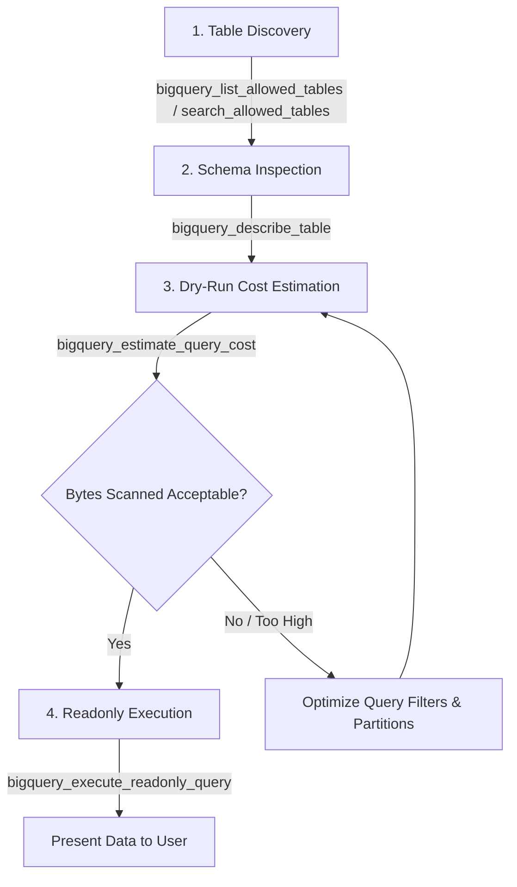

# Enterprise SaaS-to-MCP Gateway Skill

This skill guides AI agents on how to discover, inspect, estimate, and query enterprise data sources (specifically Google BigQuery) securely via the Enterprise SaaS-to-MCP Gateway.

## Available Tools

The gateway exposes the following tools to connected AI agents:
- `bigquery_list_allowed_tables`: Lists all allowlisted dataset.table identifiers accessible by the gateway.
- `bigquery_describe_table`: Fetches table schema, field descriptions, column data types, and partitioning details.
- `bigquery_search_allowed_tables`: Searches allowlisted tables and metadata using keyword matching.
- `bigquery_estimate_query_cost`: Performs a dry-run estimation of bytes scanned and projected cost for a GoogleSQL `SELECT` statement.
- `bigquery_execute_readonly_query`: Executes a read-only GoogleSQL `SELECT` query with safety guardrails (max rows capped, byte billing limits enforced).

## Mandatory Query Protocol (Guardrails)

When answering data questions or generating insights, you MUST follow this 4-step sequence:



### 1. Discovery First
- DO NOT assume or guess table or column names.
- Always call `bigquery_list_allowed_tables` or `bigquery_search_allowed_tables(keyword)` first to verify which tables are accessible.

### 2. Schema Inspection
- Call `bigquery_describe_table(datasetId, tableId)` to examine:
  - Exact column names and types.
  - Partitioning fields (`partitionField`) or clustering fields.
  - Column descriptions.

### 3. Dry-Run Cost Estimation Gate (Mandatory)
- Before running any query, ALWAYS call `bigquery_estimate_query_cost(sql)`.
- Inspect `bytesScannedFormatted` and `estimatedCostUSD`.
- If the query scans an excessive amount of data (e.g. > 1 GB for a simple lookup), optimize the query by adding partition date filters, explicit `WHERE` clauses, or selecting only necessary columns (AVOID `SELECT *` on large tables).

### 4. Read-Only Execution
- Only execute read-only queries with `bigquery_execute_readonly_query(sql)`.
- Write queries in standard GoogleSQL syntax.
- Ensure the query contains a `LIMIT` clause (the gateway enforces a hard limit of max 1000 rows).
- Never attempt `INSERT`, `UPDATE`, `DELETE`, `DROP`, or DDL statements—the gateway's policy engine will reject them.

## Setup & Connection Guides

### Cursor IDE
Add to your project's `.cursor/mcp.json` or Global Cursor Settings:
```json
{
  "mcpServers": {
    "enterprise-gateway": {
      "url": "http://localhost:3000/sse"
    }
  }
}
```

### Claude Code CLI
Run in your terminal:
```bash
claude mcp add --transport sse enterprise-gateway http://localhost:3000/sse
```
